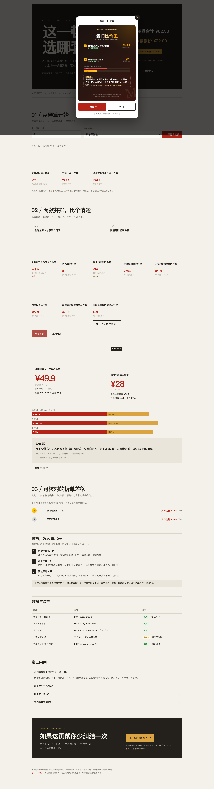
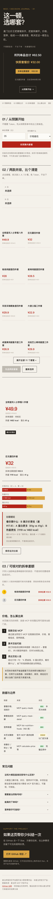

# 麦门比价王 🍔

**先按预算找三款可选套餐，再把价格、营养和组成并排比清楚。**

> 麦当劳程序员节创意开发大赛参赛作品 · 基于麦当劳官方 MCP · 使用腾讯 WorkBuddy 开发

[立即打开免 Token 体验](https://philip-xu-yu.github.io/mcd-price-king/) · [给项目点 Star](https://github.com/Philip-Xu-yu/mcd-price-king)

## 30 秒看懂

输入单份预算，从历史菜单快照筛出最多三款候选；支持按价格、拆单差额、蛋白质、热量排序。再选两个套餐，立即看到：

- 哪款菜单展示价更低、两者差多少
- 套餐所列组成项的单点参考价与拆单估算差额（无法核对时标为待核实）
- 快照中的热量、蛋白质估算对比

静态页不查询个人券；适用券和积分仅在连接个人 Token 的完整版中查看。

**免 Token 静态页只使用历史菜单快照，不会下单；完整应用才连接你的麦当劳 MCP。**

## 在线体验

- **免登录试算页**（不会下单）：https://philip-xu-yu.github.io/mcd-price-king/ （截至 2026-10-24 发布前检查仍为 404；需启用 Pages 并推送后才可访问）
- **完整应用**（本地运行，可查自己账号的券/积分；真实下单属于高级功能，默认需要明确确认）：见下方「安装」

## 截图

**完整应用（Streamlit）**：选门店 → 选套餐 → 并排比价 → 查看营养与优惠 →（可选）确认后创建订单


**免登录静态试算页**：编辑风页面，先按预算筛选，再把两款套餐并排比较



**手机布局**：预算、比价和榜单在窄屏下保持单列与横向可读



## 它解决什么问题

站在柜台前纠结“巨无霸四件套还是板烧鸡腿堡四件套”？菜单展示价、划线价和列出单品的参考价是不同口径，不能直接把它们当成券后实付。

它不要求你先懂菜单：先用免 Token 静态页看结果；需要查自己的门店、券和积分时，再连接个人 MCP Token。

麦门比价王把两件事交给确定性计算：

| 角色 | 职责 |
|------|------|
| 麦当劳 MCP | 连接个人 Token 后查询指定门店菜单、套餐组成、券和积分；营养表使用本地缓存 |
| Python 脚本 | 匹配组成项、估算拆单差额与营养，并标识无法核对的数据 |
| Streamlit 界面 | 选门店、选套餐、并排比价、展示结论 |

## 核心功能

1. **预算筛选**：按单份预算从菜单展示价筛选最多三款套餐；静态页支持价格、可计算拆单差额及营养快照排序，完整版仅在有可核对数据时提供相应排序；不叠券、不代表官方整单应付
2. **套餐比价**：A/B 两个套餐并排对比——现价、划线价、拆单差额（仅展示单品清单可核对的条目）、热量、蛋白质
3. **组成明细**：每个套餐包含什么、每样单点价多少，拆给你看
4. **麦当劳度量衡**：差价换算成"≈ N 份麦乐鸡(5块)"，蛋白差换算成"≈ N 份麦乐鸡的蛋白"
5. **一句话结论**："A 展示价更低（差 ¥X）；B 蛋白更多"——看你要什么
6. **券自动匹配**：提示套餐或套餐内单品可能适用的券；单品券显示的是该单品核价，不是整份套餐到手价
7. **选门店**：城市+区两级选择，选店后菜单自动切换为该店在售餐品
8. **券和积分**：官方算价（每张券实际省多少）、积分怎么花、一键领取可领的券
9. **可选创建订单**：确认门店、实时菜单和真实下单意图后，才调用 `create-order`；不会自动支付，状态和取消以官方接口为准

## 架构

```
用户选门店 + 选套餐 A/B
    ↓
麦当劳 MCP（mcp.mcd.cn，Streamable HTTP）
    ├── query-nearby-stores  查门店
    ├── query-meals          门店菜单
    ├── query-meal-detail    套餐组成与可替换项
    ├── list-nutrition-foods 营养数据（160 条）
    ├── query-store-coupons  门店可用券
    ├── calculate-price      官方算价（含取餐方式）
    ├── create-order         真实创建订单（到店/外送）
    ├── cancel-order         取消订单
    ├── auto-bind-coupons    一键领券
    └── query-my-account     积分
    ↓
scripts/agent.py（确定性计算，纯标准库）
    ↓
Streamlit 界面（并排比价卡 + 结论）
```

**设计原则：接口取数、代码计算、界面展示分开。** 算术可复现，但组成项的名称匹配、单点参考价及营养覆盖率仍需人工复核；算得对不等于数据来源和商品配置已核实。

## 安装

### 1. 申请 MCP Token

打开 https://open.mcd.cn/mcp → 手机号登录 → 控制台 → 激活 → 复制 Token。

### 2. 配置环境变量

```bash
export MCD_TOKEN="你的Token"
```

### 3. 安装依赖并运行

```bash
python3 -m venv .venv
.venv/bin/pip install -r requirements.txt
.venv/bin/streamlit run app.py --server.port 8766 --server.headless true --server.address 127.0.0.1
```

浏览器打开 http://127.0.0.1:8766

### 命令行快速体验

```bash
MCD_TOKEN=xxx .venv/bin/python -c "
import sys; sys.path.insert(0, 'scripts')
import agent
print(agent.compare(None, '巨无霸四件套', '板烧鸡腿堡四件套')['verdict'])
"
```

## 使用示例

**场景一：选择困难**

> 打开免 Token 试算页，或在完整应用选门店后，选「巨无霸四件套」和「板烧鸡腿堡四件套」→ 比一比
> 示例：若 A 是巨无霸四件套（¥32）、B 是板烧鸡腿堡四件套（¥28），则 B 比 A 便宜 ¥4；营养比较以当前页面实际结果为准。
> 差价换算：¥4 不到一份「香芋派」（仅作直观类比，商品价格以门店为准）。

**场景二：看看自己的券值不值**

> 「💎 我的券和积分」→ 自动展示
> 11.9 元麦辣鸡腿堡券：用券价 ¥11.9（原价 ¥22.5，省 ¥10.6）👑 全场最值

**场景三：一键领券**

> 有可领的券时点「一键全领了」→ 执行真实领券前请确认账号和券列表

**场景四：可选创建订单（高级功能）**

> 先选门店并加载实时菜单 → 完成比价 → 展开「高级功能」→ 勾选确认 → 创建真实订单
> 订单卡展示订单号、门店、应付金额和官方支付截止时间；可选择跳转官方支付页或尝试取消。实际支付与取消结果以官方接口为准。

## 自测

```bash
.venv/bin/python tests/run_tests.py
```

覆盖 16 项：数据层（菜单/营养/订单/JSON 合法性）、业务逻辑（预算筛选、比价胜负与同价、营养、度量衡）、代码完整性（Python 与静态页 JS 语法、函数齐全）、安全与合规自查。浏览器交互与响应式布局另行人工验收。

## 真实性对照表

| 数据 | 来源 | 状态 |
|------|------|------|
| 门店菜单展示价 | 连接个人 Token 后调用 MCP query-meals | 当前门店返回值；不等于券后实付 |
| 套餐组成 | MCP query-meal-detail | 默认选项；名称匹配单品仍需复核 |
| 营养数据 | 本地缓存的营养表 | 部分组成项可能缺失或模糊匹配；非当前门店实时营养 |
| 券与算价 | MCP query-store-coupons + calculate-price | 完整版按需查询；展示价不是最终核价 |
| 积分 | 连接个人 Token 后调用 MCP query-my-account | 以当前账号接口结果为准 |
| 静态页 docs/index.html | 历史请求缓存与示例整理 | 非实时；逐条采集时间、门店和组成待复核 |
| 麦当劳度量衡参考价 | 示例数据或当前菜单匹配 | 仅用于直观类比，以门店为准 |

## 目标用户

- **选择困难的人**：纠结两个套餐时直接看数据
- **想看清价格口径的人**：划线价差、拆单估算差额与券后实付不是一回事
- **麦当劳会员**：券快过期、积分怎么花，一键查清
- **关注营养的食客**：热量、蛋白、钠含量一目了然

## 目录结构

```
.
├── app.py                    # Streamlit 完整应用
├── docs/
│   ├── index.html            # 免登录静态试算页（单文件）
│   ├── data.js               # 静态页数据快照
│   └── screenshots/          # README 截图
├── scripts/
│   ├── agent.py              # 核心逻辑：比价/资产/门店/领券/下单
│   ├── mcd_client.py         # 麦当劳 MCP 客户端（纯标准库）
│   ├── data_utils.py         # 数据解析
│   ├── fetch_data.py         # 数据拉取与缓存
│   └── export_sample.py      # 生成静态页数据快照
├── tests/
│   └── run_tests.py          # 自测（16 项，离线可跑）
├── data/                     # 数据缓存（脱敏）
├── README.md
├── CONTEST_DECLARATION.md    # 参赛声明（官方原文）
├── MCP_INTEGRATION.md        # MCP 集成说明
├── mcp-config.example.json   # 脱敏配置示例
├── workbuddy.md              # WorkBuddy 开发对话上下文
└── requirements.txt
```

## 免责声明

本项目为参赛作品，非麦当劳官方产品。项目输出仅供参考，不构成医疗、营养或其他专业建议；餐品信息、价格及供应状态以麦当劳官方渠道的实时结果为准。
