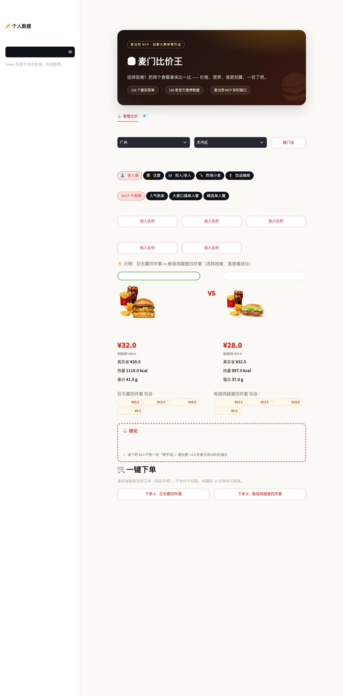
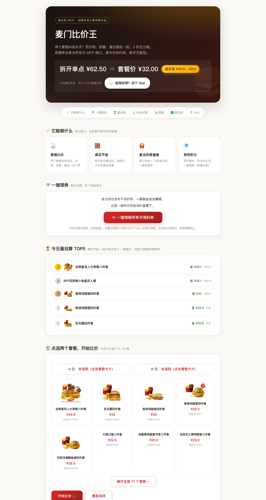
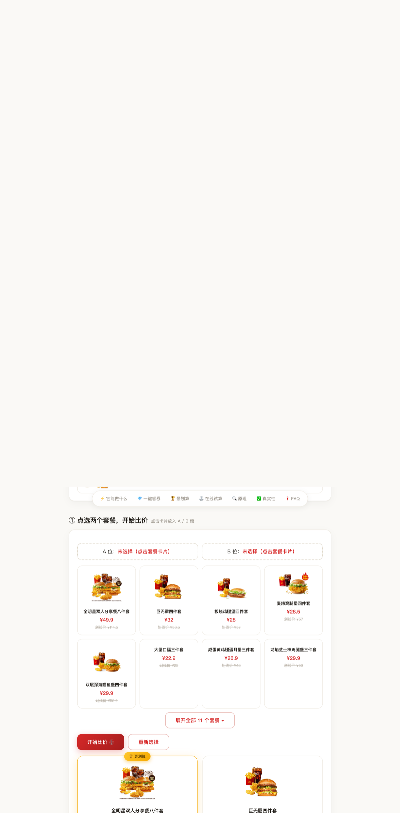

# 麦门比价王 🍔

**选择困难？把两个麦当劳套餐拿来比一比——价格、热量、蛋白，谁更划算，3 秒见分晓。**

> 麦当劳程序员节创意开发大赛参赛作品 · 基于麦当劳官方 MCP · 使用腾讯 WorkBuddy 开发

## 在线体验

- **免登录试算页**（GitHub Pages，打开即玩）：https://philip-xu-yu.github.io/mcd-price-king/
- **完整应用**（本地运行，可查自己账号的券/积分/下单）：见下方「安装」

## 截图

**完整应用（Streamlit）**：选门店 → 双排胶囊选套餐 → 并排比价 → 一键下单



**免登录静态试算页**：打开即玩，自动比出首组结果



**比价结果**：🏆 赢家高亮 + 三组对比条 + 结论 + 麦当劳度量衡



## 它解决什么问题

站在柜台前纠结"巨无霸四件套还是板烧鸡腿堡四件套"？菜单上只有划线价和套餐价，没有拆解后的真实优惠，也没有营养对比。

麦门比价王把两件事交给确定性计算：

| 角色 | 职责 |
|------|------|
| 麦当劳 MCP | 实时菜单、价格、餐品组成、营养数据、券、积分 |
| Python 脚本 | 拆解套餐组成、计算真实节省、汇总营养、换算度量衡 |
| Streamlit 界面 | 选门店、选套餐、并排比价、展示结论 |

## 核心功能

1. **套餐比价**：A/B 两个套餐并排对比——现价、划线价、真实节省（拆开单点合计 - 套餐价）、热量、蛋白质
2. **组成明细**：每个套餐包含什么、每样单点价多少，拆给你看
3. **麦当劳度量衡**：差价换算成"≈ N 份麦乐鸡(5块)"，蛋白差换算成"≈ N 份麦乐鸡的蛋白"
4. **一句话结论**："A 更省钱（省 ¥X）；B 蛋白更多"——看你要什么
5. **券自动匹配**：比价结果直接告诉你这套餐能用哪张券、用券后多少钱
6. **选门店**：城市+区两级选择，选店后菜单自动切换为该店在售餐品
7. **券和积分**：官方算价（每张券实际省多少）、积分怎么花、一键领取可领的券
8. **一键下单**：真实创建麦当劳订单（create-order），跳转官方支付页，15 分钟内可取消

## 架构

```
用户选门店 + 选套餐 A/B
    ↓
麦当劳 MCP（mcp.mcd.cn，Streamable HTTP）
    ├── query-nearby-stores  查门店
    ├── query-meals          门店菜单
    ├── query-meal-detail    套餐组成与可替换项
    ├── list-nutrition-foods 营养数据（160 条）
    ├── query-store-coupons  门店可用券
    ├── calculate-price      官方算价（含取餐方式）
    ├── create-order         真实创建订单（到店/外送）
    ├── cancel-order         取消订单
    ├── auto-bind-coupons    一键领券
    └── query-my-account     积分
    ↓
scripts/agent.py（确定性计算，纯标准库）
    ↓
Streamlit 界面（并排比价卡 + 结论）
```

**设计原则：取数交给 MCP，算术交给代码，展示交给界面。** 营养求和、单点拆解、差价换算全部是确定性计算，不依赖大模型推理，数字可复现、可核验。

## 安装

### 1. 申请 MCP Token

打开 https://open.mcd.cn/mcp → 手机号登录 → 控制台 → 激活 → 复制 Token。

### 2. 配置环境变量

```bash
export MCD_TOKEN="你的Token"
```

### 3. 安装依赖并运行

```bash
python3 -m venv .venv
.venv/bin/pip install -r requirements.txt
.venv/bin/streamlit run app.py --server.port 8766 --server.headless true --server.address 127.0.0.1
```

浏览器打开 http://127.0.0.1:8766

### 命令行快速体验

```bash
MCD_TOKEN=xxx .venv/bin/python -c "
import sys; sys.path.insert(0, 'scripts')
import agent
print(agent.compare(None, '巨无霸四件套', '板烧鸡腿堡四件套')['verdict'])
"
```

## 使用示例

**场景一：选择困难**

> 选「巨无霸四件套」和「板烧鸡腿堡四件套」→ 比一比
> 结果：A 更省钱（省 ¥4）；A 蛋白更多（41g vs 37g）；B 热量更低（997 vs 1119 kcal）
> 度量衡：省下的 ¥4 不到一份「香芋派」

**场景二：看看自己的券值不值**

> 「💎 我的券和积分」→ 自动展示
> 11.9 元麦辣鸡腿堡券：用券价 ¥11.9（原价 ¥22.5，省 ¥10.6）👑 全场最值

**场景三：一键领券**

> 有可领的券时点「一键全领了」→ 自动领取（实测可领到免费脆薯饼）

**场景四：一键下单**

> 比价结果底部点「下单 A」→ 真实创建麦当劳订单（到店外带）
> 订单卡：订单号、门店、应付金额、15 分钟支付时限
> 「💳 去支付」跳转麦当劳官方支付页；反悔点「取消订单」即时撤销

## 自测

```bash
.venv/bin/python tests/run_tests.py
```

覆盖 12 项：数据层（菜单/营养/订单/JSON 合法性）、业务逻辑（营养求和/度量衡）、代码完整性（6 个 Python 文件语法 + 静态页 JS 语法 + 函数齐全）、合规自查（无讽刺性文案，符合大赛规则）、密钥泄露检查。

## 真实性对照表

| 数据 | 来源 | 状态 |
|------|------|------|
| 菜单与价格 | MCP query-meals | ✅ 真实实时 |
| 套餐组成 | MCP query-meal-detail | ✅ 真实实时 |
| 营养数据 | MCP list-nutrition-foods | ✅ 真实（官方 160 条） |
| 券与算价 | MCP query-store-coupons + calculate-price | ✅ 真实实时 |
| 积分 | MCP query-my-account | ✅ 真实（演示账号） |
| 静态页 docs/index.html | 真实请求快照 | 🟡 非实时，页内已标注 |
| 麦当劳度量衡参考价 | 示例数据 | 🟡 以门店为准 |

## 目标用户

- **选择困难的人**：纠结两个套餐时直接看数据
- **想算清真实优惠的人**：划线价 ≠ 真实节省，拆开单点才知道
- **麦当劳会员**：券快过期、积分怎么花，一键查清
- **关注营养的食客**：热量、蛋白、钠含量一目了然

## 目录结构

```
.
├── app.py                    # Streamlit 完整应用
├── docs/
│   ├── index.html            # 免登录静态试算页（单文件）
│   ├── data.js               # 静态页数据快照
│   └── screenshots/          # README 截图
├── scripts/
│   ├── agent.py              # 核心逻辑：比价/资产/门店/领券/下单
│   ├── mcd_client.py         # 麦当劳 MCP 客户端（纯标准库）
│   ├── data_utils.py         # 数据解析
│   ├── fetch_data.py         # 数据拉取与缓存
│   └── export_sample.py      # 生成静态页数据快照
├── tests/
│   └── run_tests.py          # 自测（12 项，离线可跑）
├── data/                     # 数据缓存（脱敏）
├── README.md
├── CONTEST_DECLARATION.md    # 参赛声明（官方原文）
├── MCP_INTEGRATION.md        # MCP 集成说明
├── mcp-config.example.json   # 脱敏配置示例
├── workbuddy.md              # WorkBuddy 开发对话上下文
└── requirements.txt
```

## 免责声明

本项目为参赛作品，非麦当劳官方产品。项目输出仅供参考，不构成医疗、营养或其他专业建议；餐品信息、价格及供应状态以麦当劳官方渠道的实时结果为准。
